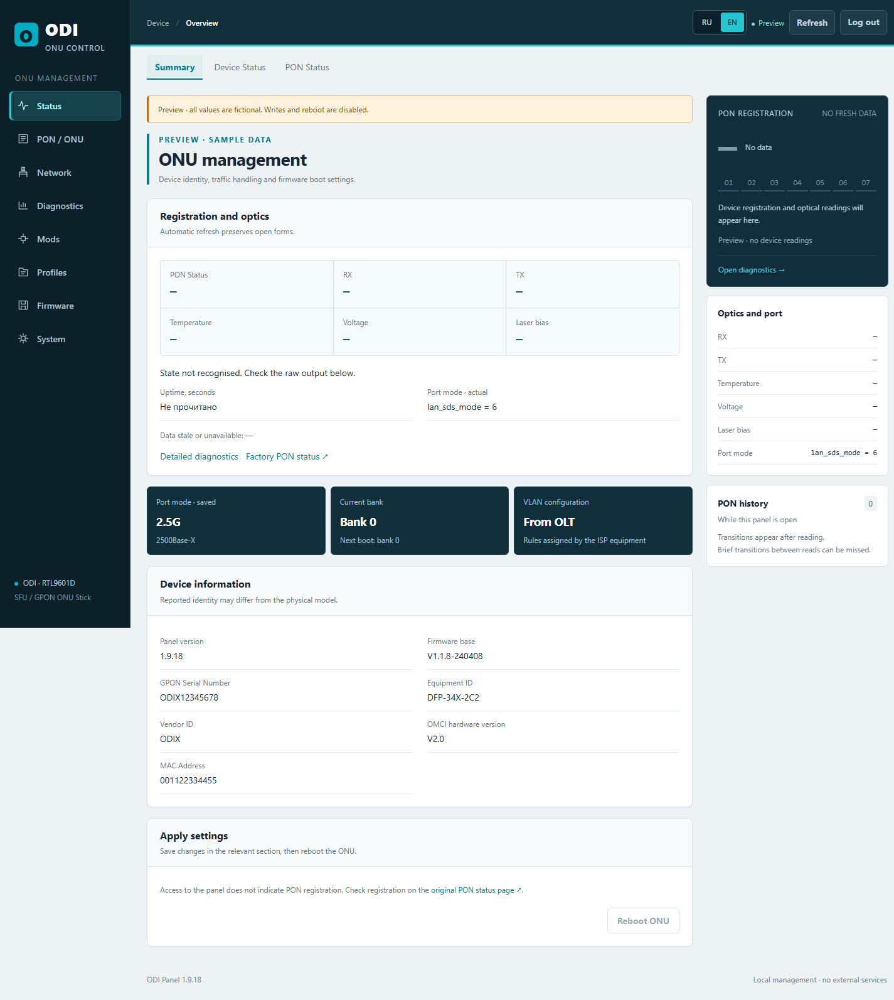
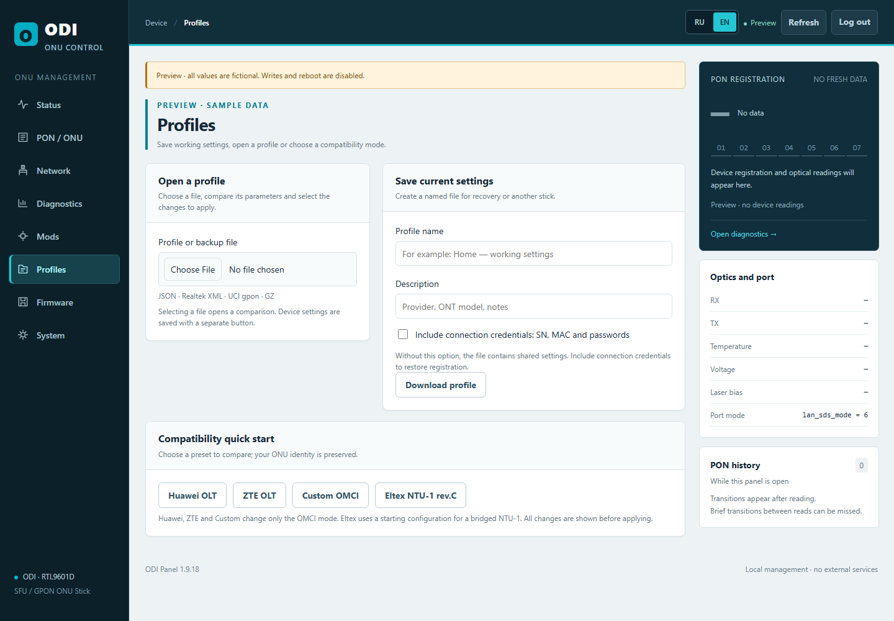
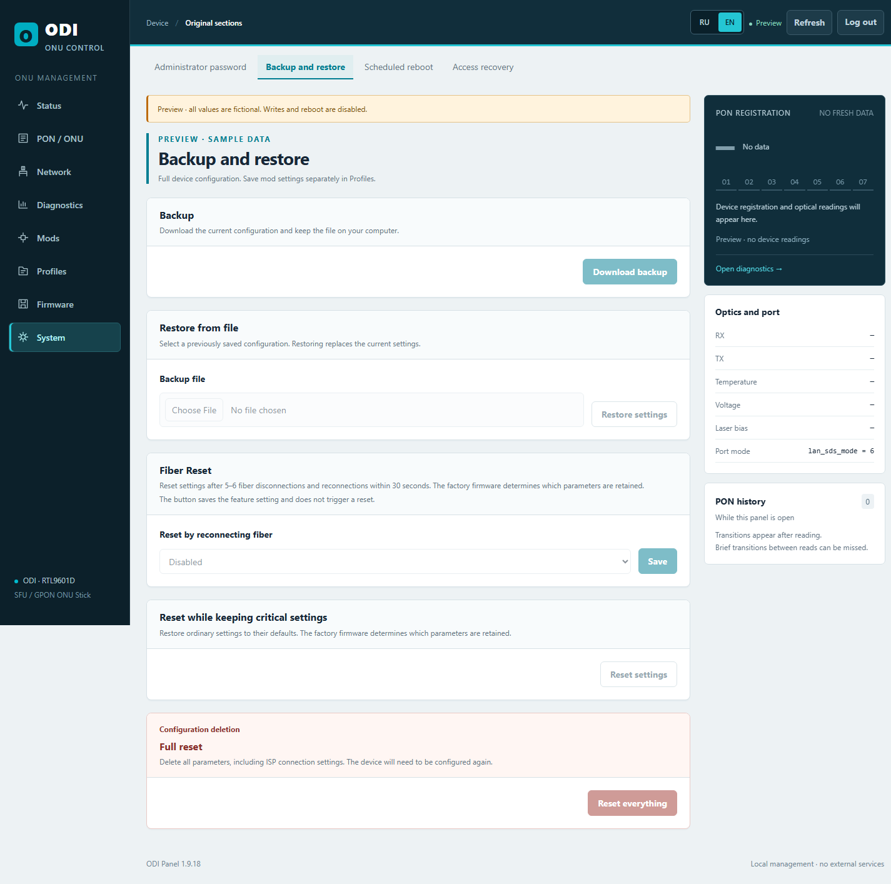
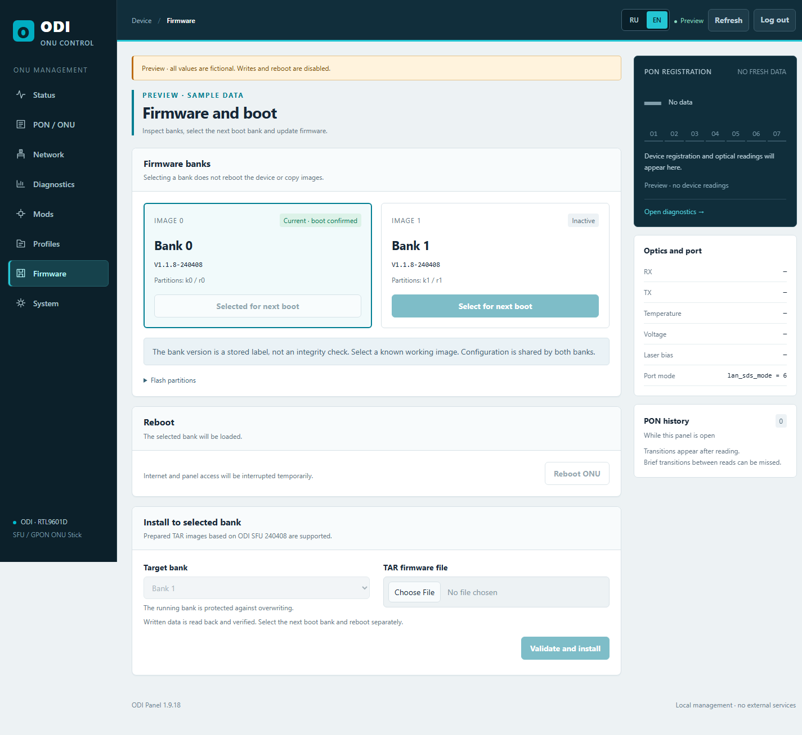
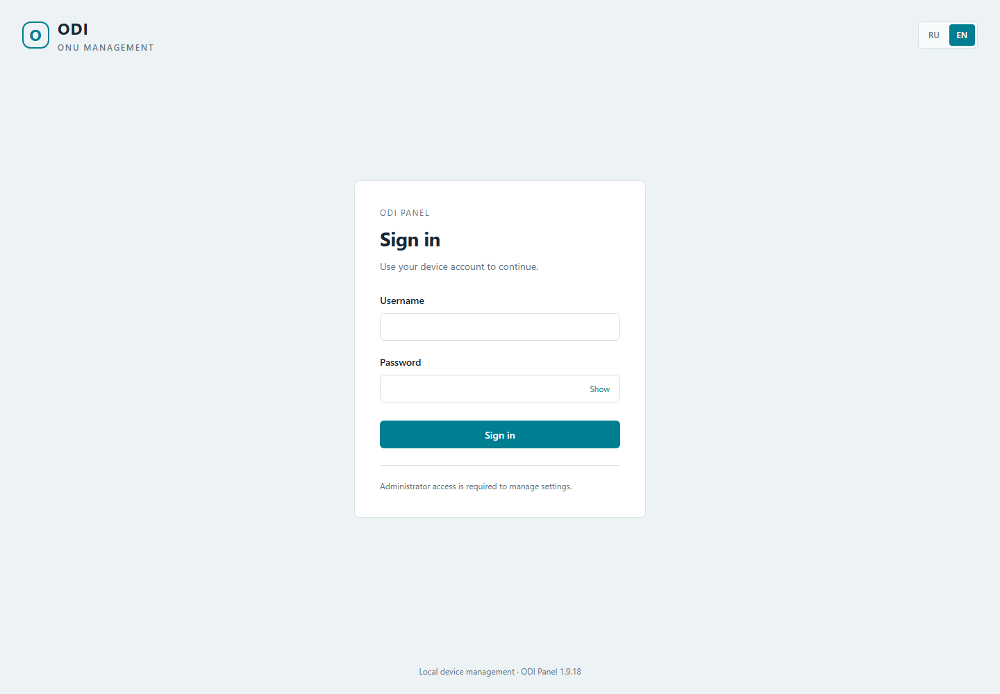
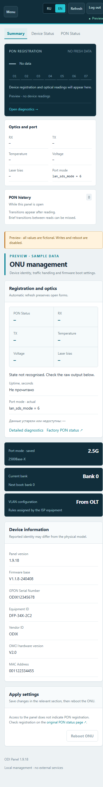

# ODI Panel 1.9.18

[Русский](README.md) · **English**

A web interface for Realtek RTL9601D GPON SFP sticks based on **ODI SFU V1.1.8-240408 / X100SFP**. Configure connections, inspect diagnostics, manage profiles and update either firmware bank in English or Russian.

[Download TAR](https://github.com/stepm65/SFP-ONU/releases/download/v1.9.18/ODI-Panel-1.9.18-RU-EN-SFU-240408.tar) · [Release and source ZIP](https://github.com/stepm65/SFP-ONU/releases/tag/v1.9.18) · [Installation guide](odi-panel/docs/03-INSTALL-AND-RECOVERY-RU.md)



Screenshots show the offline preview with fictional data. Download and open [preview.html](odi-panel/preview.html) locally; device writes are disabled.

## Interface

- **Status:** O1–O7 registration, optics, bank and port settings. The diagnostic rail is always visible and appears above forms on smaller screens.
- **PON / ONU:** GPON serial, PLOAM, LOID, OMCI settings, MAC and local MACKEY calculation.
- **Network:** VLAN, SFP mode and embedded LAN settings. WAN forms are enabled only when exposed by the factory menu.
- **Diagnostics:** OMCI tables, connection events and TCP syslog. A separate full debug mode captures RAW OMCI and private credentials.
- **Profiles:** import, compare selected fields and export settings. Compatibility presets show changes before applying them.
- **System → Backup and restore:** device configuration backup, restore and separate reset actions. Save mod settings in a panel profile as well.
- **Firmware:** upload TAR to the inactive bank with validation before writing and a read-back check afterward. Boot selection and reboot are separate actions.
- **RU / EN:** buttons in the header and sign-in page preserve form drafts when switching language.
- **Sign out:** uses the factory session handler, confirms the sign-in page at the root address and opens `/`. No intermediate Logout page; unsaved changes still require confirmation.

| Profiles | Backup and restore |
|---|---|
|  |  |



| Sign in | Mobile |
|---|---|
|  |  |

## Compatibility and installation

Requires the **SFU 240408** base, **X100SFP** hardware tag and flash layout: k0/k1 `0x14c000`, r0/r1 `0x274000`. A model name alone does not establish compatibility. The factory uploader does not perform the panel's additional checks.

1. Back up the device under System → Backup and restore, and export a profile for mod settings.
2. Under Firmware, select the running bank for the next boot, then upload the TAR into the other bank. Wait for a verified write.
3. Select the verified bank and reboot separately.
4. Open `http://<stick address>/` and check version **1.9.18** and PON registration.

For initial installation from factory firmware, use its Firmware Upgrade page after checking the platform and partitions. Upload TAR, not ZIP. If a write is unconfirmed, inspect its status before switching banks.

See [SHA256SUMS](firmware/SHA256SUMS) and [validation reports](firmware/reports/1.9.18/). UI and sign-out changes were tested in Chromium with local device-response fixtures; physical testing of 1.9.18 remains pending. Compatibility with a particular OLT, including Eltex, depends on its configuration and OMCI implementation.

## Source and documentation

The Russian guides cover [installation](odi-panel/docs/03-INSTALL-AND-RECOVERY-RU.md), [Eltex NTU-1](odi-panel/docs/05-ELTEX-NTU1-RU.md), [syslog](odi-panel/docs/06-CONNECTION-LOGGING-RU.md), [full debug](odi-panel/docs/07-FULL-DEBUG-RU.md) and [web updates](odi-panel/docs/08-WEB-UPDATE-AND-SESSION-RU.md).

`odi-panel/src/` contains the panel and device scripts; `odi-panel/test_*` contains tests. Building requires Python 3, BeautifulSoup, Node.js and squashfs-tools with LZMA and pseudo-file support. Device scripts use only commands listed in `odi-panel/device-commands.txt`.

```sh
python3 odi-panel/build.py firmware/original/M110_sfp_ODI_SFU_240408.tar /usr/bin release-1.9.18-sfu
```

Kernel, drivers and OMCI come from ODI SFU 240408; Boa includes the panel CGI routing patch. Mods are adapted from [Anime4000/RTL960x](https://github.com/Anime4000/RTL960x); upstream sources and license are preserved in `odi-panel/upstream/`. MD5 uses Paul Johnston's BSD-licensed implementation.
