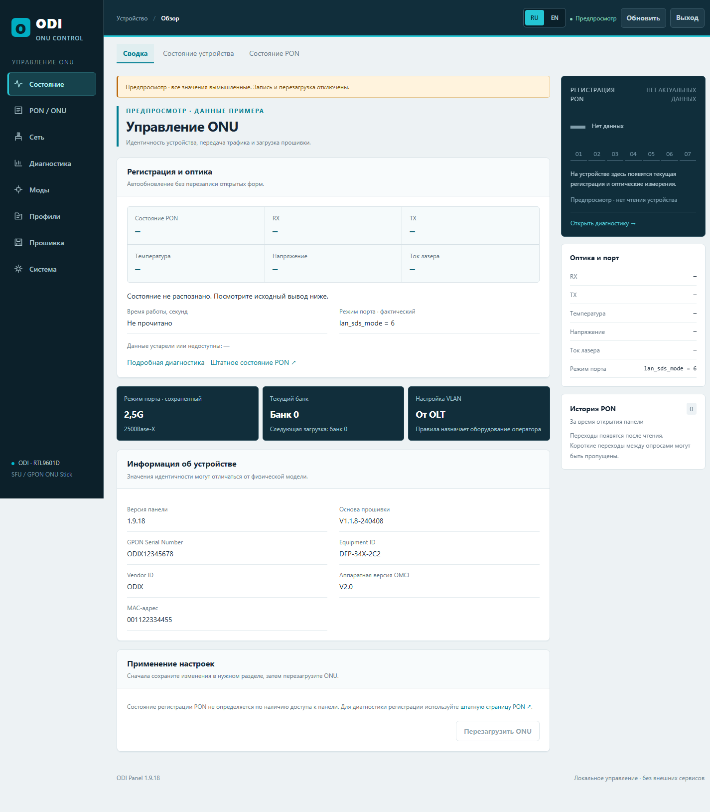
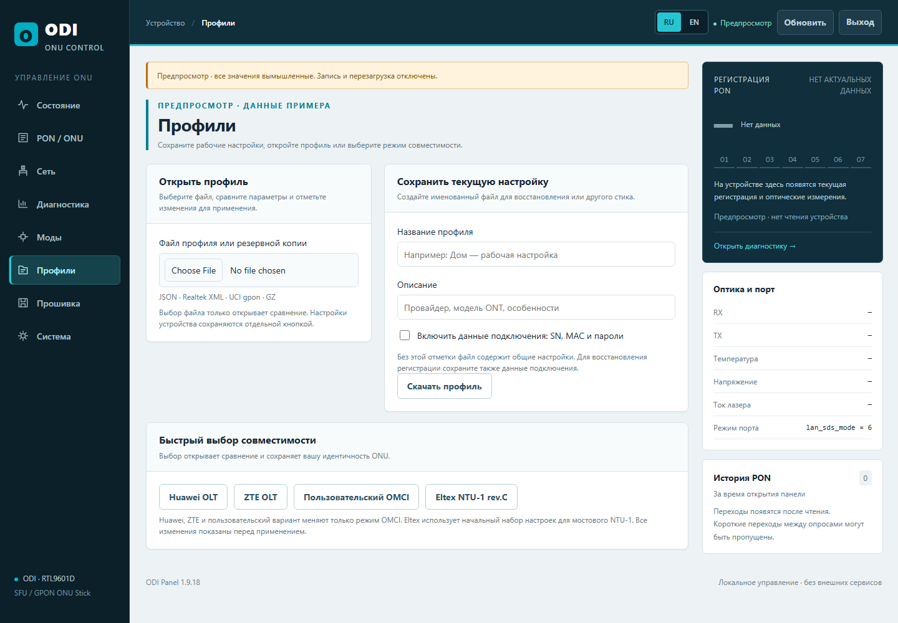
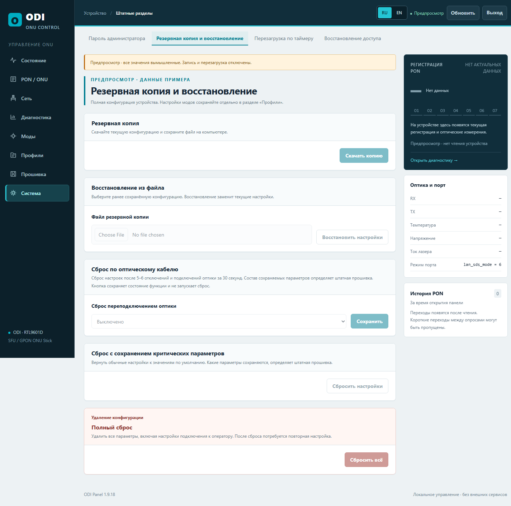
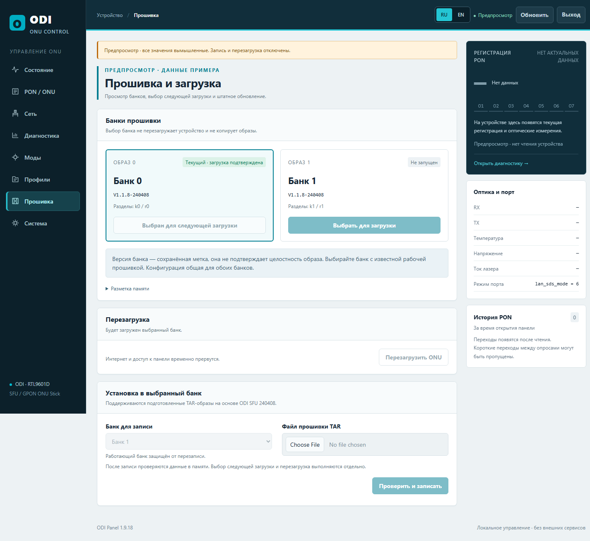
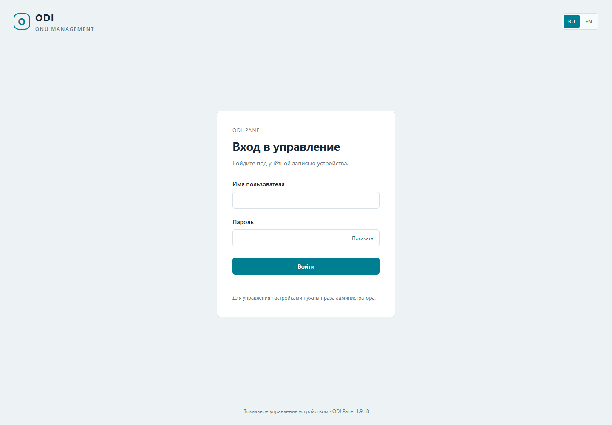
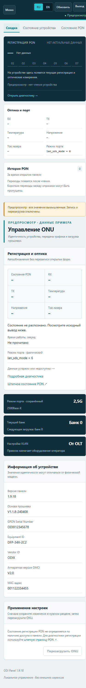

# ODI Panel 1.9.18

**Русский** · [English](README.en.md)

Веб-интерфейс для GPON SFP-стиков на платформе Realtek RTL9601D с базовой прошивкой **ODI SFU V1.1.8-240408 / X100SFP**. Настройка подключения, диагностика, профили и обновление двух банков — на русском и английском языке.

[Скачать TAR](https://github.com/stepm65/SFP-ONU/releases/download/v1.9.18/ODI-Panel-1.9.18-RU-EN-SFU-240408.tar) · [Выпуск и ZIP с исходниками](https://github.com/stepm65/SFP-ONU/releases/tag/v1.9.18) · [Инструкция установки](odi-panel/docs/03-INSTALL-AND-RECOVERY-RU.md)



Скриншоты сделаны в предпросмотре 1.9.18 с вымышленными данными. [Предпросмотр](odi-panel/preview.html) можно скачать и открыть локально; запись настроек в нём отключена.

## Интерфейс

- **Состояние:** регистрация O1–O7, оптические показатели, текущий банк и настройки порта. Панель диагностики всегда открыта; на небольшом экране она располагается над формами.
- **PON / ONU:** GPON SN, PLOAM, LOID, параметры OMCI, MAC и локальный расчёт MACKEY.
- **Сеть:** VLAN, режим SFP, встроенная страница LAN; WAN-формы доступны, если их предоставляет штатное меню устройства.
- **Диагностика:** таблицы OMCI, журнал подключения и TCP syslog. Отдельный режим полной отладки сохраняет RAW OMCI и приватные данные.
- **Профили:** импорт, сравнение выбранных полей и экспорт настроек. Пресеты совместимости показывают изменения перед записью.
- **Система → Резервная копия и восстановление:** полная конфигурация устройства, восстановление и отдельные действия сброса. Настройки модов дополнительно сохраняются в профиле панели.
- **Прошивка:** загрузка TAR в неактивный банк с проверкой до и после записи. Выбор банка и перезагрузка выполняются отдельно.
- **RU / EN:** переключатель в шапке и на странице входа. Смена языка сохраняет введённые данные.
- **Выход:** штатное завершение сессии без промежуточной страницы Logout; после подтверждения открывается `/`. Несохранённые изменения требуют подтверждения.

| Профили | Резервная копия и восстановление |
|---|---|
|  |  |



| Вход | На телефоне |
|---|---|
|  |  |

## Совместимость и установка

Сборка рассчитана на базу **SFU 240408**, аппаратный тег **X100SFP** и разметку flash: k0/k1 — `0x14c000`, r0/r1 — `0x274000`. Одного названия модели недостаточно для подтверждения совместимости. Заводская страница обновления не выполняет дополнительные проверки панели.

1. Сохраните конфигурацию через «Система → Резервная копия и восстановление» и экспортируйте нужный профиль с модами.
2. В разделе «Прошивка» выберите текущий банк для следующей загрузки, затем загрузите TAR в другой банк. Дождитесь сообщения «Прошивка записана и проверена».
3. Выберите проверенный банк для загрузки и перезагрузите стик отдельной кнопкой.
4. Откройте `http://<адрес стика>/` и проверьте версию панели **1.9.18** и регистрацию PON.

Для первоначальной установки с заводского интерфейса используйте штатную страницу Firmware Upgrade, предварительно проверив совместимость и разметку. Загружается TAR, а не ZIP. При неподтверждённой записи сначала проверьте статус банка; не переключайтесь на него по одному сообщению установщика.

Контрольная сумма: [SHA256SUMS](firmware/SHA256SUMS). [Отчёты проверки](firmware/reports/1.9.18/) содержат результаты программных тестов. Изменения интерфейса и выхода проверены в Chromium с имитацией ответа устройства; физическая проверка 1.9.18 ещё не выполнена. Совместимость с конкретной OLT, включая Eltex, зависит от её конфигурации и реализации OMCI.

## Документация и исходники

- [Установка и восстановление](odi-panel/docs/03-INSTALL-AND-RECOVERY-RU.md)
- [Подключение вместо Eltex NTU-1](odi-panel/docs/05-ELTEX-NTU1-RU.md)
- [Журнал и syslog](odi-panel/docs/06-CONNECTION-LOGGING-RU.md)
- [Полная отладка OMCI](odi-panel/docs/07-FULL-DEBUG-RU.md)
- [Обновление и веб-сессия](odi-panel/docs/08-WEB-UPDATE-AND-SESSION-RU.md)
- `odi-panel/src/` — HTML, CSS, JavaScript, CGI и скрипты; `odi-panel/test_*` — проверки.

Сборка требует Python 3, BeautifulSoup, Node.js и squashfs-tools с LZMA и поддержкой pseudo files. Скрипты устройства используют только команды из `odi-panel/device-commands.txt`.

```sh
python3 odi-panel/build.py firmware/original/M110_sfp_ODI_SFU_240408.tar /usr/bin release-1.9.18-sfu
```

Ядро, драйверы и OMCI взяты из заводской базы ODI SFU 240408; Boa содержит патч маршрутизации CGI панели. Моды адаптированы из [Anime4000/RTL960x](https://github.com/Anime4000/RTL960x), исходники и лицензия сохранены в `odi-panel/upstream/`. Расчёт MD5 использует реализацию Paul Johnston под BSD-лицензией.
